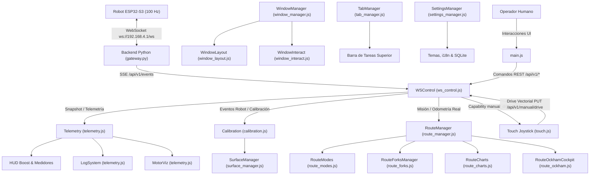

# Arquitectura JavaScript del HMI Canónico (`desktop_app/robot_app/hmi/js/`)

Este directorio contiene los módulos JavaScript del **Frontend Canónico (HMI)** para el robot diferencial 4WD basado en **ESP32-S3** (`robot-s3-steps-v3` / firmware `v3.7+`).

El sistema implementa una interfaz de estación de control para telemetría en tiempo real (100 Hz), calibración física basada en giróscopo MPU6050, planificación cartográfica de rutas con retorno Ockham, control manual táctil (Pointer Events) y gestión multi-panel de ventanas estilo sistema operativo (Pestañas, Mosaico Vertical con doble scroll y Flotante).

---

## 1. Principios de Arquitectura y Seguridad

### 1.1 Modularidad Estricta ($\le 500$ líneas por módulo)
Ningún archivo JavaScript excede las 500 líneas (rango estándar 100–495 líneas). Los métodos y funciones cumplen el Principio de Responsabilidad Única (SRP), manteniendo una longitud de entre 15 y 45 líneas, desacoplando la lógica de dominio en módulos especializados.

### 1.2 Vanilla Moderno sin Dependencias Pesadas
El frontend prescinde deliberadamente de frameworks pesados (React, Vue, Angular) en favor de JavaScript modular nativo (ES6+), renderizado DOM directo y **Chart.js** con plugins de datalabels y zoom para lienzos cartográficos. Esto garantiza arranque instantáneo, latencia mínima en tablets Android e inmunidad ante incompatibilidades de WebViews empotrados.

### 1.3 Política de Seguridad de Contenido (CSP) y Token Local
- **CSP Estricto**: `web.py` inyecta un `nonce` criptográfico dinámico por cada petición HTTP. Quedan prohibidos scripts en línea sin nonce, `unsafe-inline` o `unsafe-eval`.
- **Autenticación `X-App-Token`**: Al iniciarse el servidor backend de Python, se genera un token de aplicación inyectado en `<meta name="app-token">`. Cada petición REST hacia `/api/v1/*` y cada invocación a endpoints críticos (`/api/v1/commands`, `/api/v1/estop`, `/api/v1/manual/*`) debe incluir la cabecera `X-App-Token`.
- **Propiedad Única de WebSocket**: El navegador **nunca** se conecta directamente por WebSocket al ESP32. En su lugar, el backend en Python (`gateway.py`) es el dueño único del WebSocket hacia el robot (`ws://192.168.4.1/ws`), reenviando la telemetría al navegador mediante **Server-Sent Events (SSE)** en `/api/v1/events` y despachando comandos mediante REST.

### 1.4 Ensamblado Modular y Verificación (`compilar_hmi.py`)
El archivo maestro `index.html` actúa como esqueleto ligero. El script `compilar_hmi.py` concatena y valida los 18 módulos en el orden estricto de dependencias definido por `JS_ORDER`:

```python
JS_ORDER = [
    "config.js",
    "ws_control.js",
    "surface_manager.js",
    "calibration.js",
    "telemetry.js",
    "fork_registry.js",
    "window_interact.js",
    "window_layout.js",
    "window_manager.js",
    "route_modes.js",
    "route_forks.js",
    "route_charts.js",
    "route_ockham.js",
    "route_manager.js",
    "tab_manager.js",
    "touch.js",
    "settings_manager.js",
    "main.js",
]
```

---

## 2. Diagrama de Flujo de Datos y Eventos



---

## 3. Catálogo Detallado de los 18 Módulos JavaScript

### 3.1 `config.js` — Constantes de Protocolo, Estado Global y Chart Base
- **Propósito**: Define los contratos canónicos de firmware y aloja el estado global reactivo de la aplicación.
- **Estructuras Principales**:
  - `CANONICAL_CONFIG`: Define `PROTOCOL_NAME = 'robot-s3-steps-v3'`, `EXPECTED_FIRMWARE = 'robot-s3-v3.7'`, y el conjunto de comandos autorizados `SUPPORTED_COMMANDS: Set(['calibrate','step','turn_to','stop','estop','clear_fault','set_comp','reset_pose'])`.
  - `CONFIG`: Límites de UI (`MAX_RPM_VISUAL`, `MIN_RPM_VISUAL`, `TRAIL_MAX`, `LOG_MAX`, `JOYSTICK_MAX_RADIUS = 108`, `JOYSTICK_DEAD_ZONE = 18`).
  - `state`: Objeto mutable global que contiene conexión (`connected`), estado FSM de la UI (`estado`), telemetría cruda en memoria, filtros de bitácora, vector de joystick (`joy`) y soporte de conducción manual (`manualDriveSupported`).
  - `initChart()` / `robotChart`: Gráfica base de dispersión de `tab_mapa.html`.

### 3.2 `ws_control.js` — Transporte SSE, API REST y Despacho de Comandos
- **Propósito**: Capa de red que conecta la interfaz con los servicios REST y la cola de eventos SSE del servidor local de Python.
- **Objeto**: `WSControl`
- **Responsabilidades**: Conexión SSE `/api/v1/events`, wrappers `api()` con token `X-App-Token`, validación de comandos con `send()`, control manual `manual()`, y despacho de telemetría de 100 Hz con `applyBackendTelemetry(raw)`.

### 3.3 `surface_manager.js` — Gestor de Superficies y Perfiles de Fricción
- **Propósito**: Administra perfiles cinemáticos y de fricción en SQLite vía API REST `/api/v1/calibration/surfaces`.
- **Objeto**: `SurfaceManager`
- **Capacidades**: Persistencia y carga de perfiles de superficie (acrílico, madera, alfombra), guardado automático post-calibración con nombre diferido (`pendingAutoSaveName`), y aplicación dinámica de coeficientes de torque (`set_comp`).

### 3.4 `calibration.js` — Dogma Canónico de Calibración MPU6050 y Panel de Conexión
- **Propósito**: FSM de calibración física del robot con autoridad angular MPU6050 y gestión del panel de conexión.
- **Objetos**: `Calibration`, `ConnectionPanel`
- **Dogma Canónico**:
  1. Reposo y estabilización MPU6050 (5.0 s).
  2. Búsqueda de torque positivo (`CAL_A`): Rampa de 140 a 247/255 hasta validar ticks bilaterales y $\omega_z \ge 0.12\text{ rad/s}$ sostenido por 100 ms.
  3. Validación de giro a $+25^\circ$ (`CAL_VALIDAR_25`) con reposo de 600 ms.
  4. Reposo de 2.5 s y búsqueda de torque opuesto (`CAL_B`) con polaridad inversa.
  5. Retorno estricto a origen (`CAL_RETORNO`), reseteando odometría $(0,0)$ e IMU.
- **Panel de Conexión (`ConnectionPanel`)**: Control de conexión/reconexión de host robot y visualización de historial de sesiones SQLite (`/api/v1/sessions`).

### 3.5 `telemetry.js` — Logs Jerárquicos, Instrumentación y Visualización de Ruedas
- **Propósito**: Mantiene el historial de eventos del sistema, anima las ruedas 4WD según PWM/dirección y gobierna la instrumentación del chasis.
- **Componentes**: `LogSystem` (bitácora circular de 500 registros con filtros activos y exportación TXT), `MotorViz` (animación 60 FPS de rotación de ruedas TT interpoladas por PWM), `EncoderSpeed` (medición de frecuencia de pulsos), y `Telemetry` (insignias reactivas de estado FSM y distancias).

### 3.6 `fork_registry.js` — Registro Extensible de Submódulos y Widgets
- **Propósito**: Registro desacoplado para instanciación de ventanas secundarias y widgets flotantes.
- **Objeto**: `HMI_FORK_REGISTRY`
- **Submódulos Integrados**: `hud_boost` (HUD Cinético y Boost DRV8833 con acelerómetro e inclinómetro) y `route_fork` (bifurcaciones de rutas para comparación A/B).

### 3.7 `window_interact.js` — Interacción Táctil y Redimensión de Ventanas
- **Propósito**: Gestión táctil y Pointer Events de bajo nivel para ventanas del espacio de trabajo.
- **Objeto**: `WindowInteract`
- **Funcionalidades**:
  - `startDrag`: Arrastre fluido de ventanas flotantes por cabecera con elevación z-index y captura de puntero.
  - `startResize`: Tirador táctil ergonómico de 28px (`.window-resize-handle`) con soporte en modo flotante y mosaico vertical, ajustando `tilingHeight` y notificando redibujado de charts.
  - `initTilingObservers`: Observadores `ResizeObserver` para sincronización de dimensiones.

### 3.8 `window_layout.js` — Máquina de Estados de Disposición del Workspace
- **Propósito**: Aplica y computa las disposiciones visuales del espacio de trabajo multi-panel.
- **Objeto**: `WindowLayout`
- **Modos Implementados**:
  - `applyTabs`: Vista de pestañas clásica maximizada.
  - `applyTiling`: **Mosaico Vertical Stacking** al 100% de ancho con scroll general `#hmi-workspace` y scroll independiente por tarjeta.
  - `applyFloating`: Ventanas flotantes arrastrables con capas z-index.
  - `renderForkMenu`: Renderizado dinámico del menú de submódulos y widgets (`···`).

### 3.9 `window_manager.js` — Orquestador de Ventanas y Barra de Tareas
- **Propósito**: Fachada principal de gestión de ventanas estilo escritorio.
- **Objeto**: `WindowManager`
- **Capacidades**: Registro de paneles (`tab-conexion`, `tab-mapa`, `tab-testing`, `tab-touch`, `tab-rutas`, `tab-boost`), barra de tareas dinámica (`ensureTaskbarButton`), ciclo de vida (`openWindow`, `minimizeWindow`, `restoreWindow`, `maximizeWindow`, `closeWindow`), elevación de z-index (`bringToFront`) y selector de modos (`setMode`).

### 3.10 `route_modes.js` — Modos Polimórficos de Planificación Cartográfica
- **Propósito**: Jerarquía de clases para los modos de entrada y descomposición cinemática de trayectorias.
- **Clases y Exportaciones**:
  - `RoutePlanningMode`: Clase base abstracta.
  - `RectangularRouteMode`: Modos cartesianos $(X, Y)$ con avance ortogonal y bloqueo de eje.
  - `AngularRouteMode`: Modo polar con giro previo y traslación recta.
  - `AngularDecompositionRouteMode`: Descomposición polar en componentes ortogonales $(\Delta X, \Delta Y)$.
  - `AngularVectorialRouteMode`: Modo vectorial continuo experimental con validación bilateral de encoders y MPU.
  - `ROUTE_PLANNING_MODES`: Diccionario de estrategias de planificación.

### 3.11 `route_forks.js` — Gestor de Ramificaciones y Rutas A/B
- **Propósito**: Gestión de múltiples alternativas de rutas (forks), alternancia de ramas y análisis comparativo.
- **Objeto**: `RouteForksManager`
- **Capacidades**: Creación de forks clonados (`fork`), conmutación de ramas activas (`switchBranch`), overlay comparativo A/B con cálculo diferencial de longitud y waypoints (`toggleCompareAB`), y persistencia en `localStorage`.

### 3.12 `route_charts.js` — Renderizado Cartográfico Dual (Chart.js) y Modo Cine
- **Propósito**: Renderizado gráfico de trayectorias teóricas y telemetría real en lienzos Chart.js.
- **Objeto**: `RouteCharts`
- **Lienzos y Plugins**:
  - `planChart`: Lienzo de ruta teórica planificada con flechas directivas y etiquetas de paso.
  - `telemChart`: Lienzo de trayectoria real del robot en tiempo real (100 Hz).
  - `routeAngularOverlay`: Plugin para proyección visual de arcos angulares y vectores.
  - `routeEndpointTolerance`: Plugin de visualización de radios de tolerancia en waypoints.
  - `toggleCinema`: Modo cine a pantalla completa independiente para `Cine (Plan)` y `Cine (Telemetría)`.

### 3.13 `route_ockham.js` — Cockpit de Retorno Seguro a Origen (Navaja de Ockham)
- **Propósito**: Retorno determinista invirtiendo la secuencia de waypoints ($W_N \to \dots \to W_0$) mediante avance frontal (`forward`).
- **Objeto**: `RouteOckhamCockpit`
- **Protocolo Ockham**:
  - Simulación y confirmación previa en modal `#route-ockham-confirm-box`.
  - Etapa de reposo (settling de 500 ms) tras cada tramo para evaluar errores de exactitud (longitudinal, lateral y angular).
  - Realineación dinámica ortogonal si el desvío angular supera $1.5^\circ$ o el lateral supera $2.5\text{ cm}$.
  - Registro de auditoría de precisión en base de datos SQLite.

### 3.14 `route_manager.js` — Fachada y Orquestación del Programador de Rutas
- **Propósito**: Coordinador central de la pestaña de rutas.
- **Objeto**: `RouteManager`
- **Responsabilidades**: Enlace de controles y formularios de entrada, validación de cuotas (máx. 256 waypoints), bloqueo dinámico de modo, actualización de tabla de recorrido (`updateListUI`), ciclo de vida de misiones (`start`, `stopAndReset`, `clearRobotMemory`, `onMission`), y delegación fluida a `RouteModes`, `RouteCharts`, `RouteForksManager` y `RouteOckhamCockpit`.

### 3.15 `tab_manager.js` — Navegación de Pestañas y Accesibilidad WAI-ARIA
- **Propósito**: Navegación por teclado y ratón entre pestañas principales.
- **Objeto**: `TabManager`
- **Funcionalidades**: Sincronización WAI-ARIA (`role="tab"`, `aria-selected`, navegación con flechas/Home/End), validación de bloqueo durante ejecución o calibración, y auto-scroll suave (`scrollIntoView`) en modo mosaico.

### 3.16 `touch.js` — Conducción Manual Táctil y Joystick Virtual
- **Propósito**: Conducción manual continua por joystick virtual mediante Pointer Events.
- **Objeto**: `Touch`
- **Detalles Técnicos**: Captura de puntero (`setPointerCapture`) en SVG interactivo, cinemática diferencial con zona muerta (`JOYSTICK_DEAD_ZONE = 18px`), corte instantáneo a PWM 0 al soltar (`Touch.end()`), leasing de seguridad en backend y grabación/reproducción de maniobras.

### 3.17 `settings_manager.js` — Preferencias de Usuario, Temas e i18n
- **Propósito**: Centraliza la personalización del entorno HMI.
- **Objeto**: `SettingsManager`
- **Capacidades**: Selección de temas (`cyber-dark`, `light-glass`, `high-contrast`), soporte multi-idioma i18n (`es`, `en`) con actualización dinámica del DOM (`applyTranslations`), modo de espacio de trabajo inicial, persistencia en `localStorage` y sincronización bidireccional con SQLite vía `/api/v1/config/user-settings`.

### 3.18 `main.js` — Punto de Entrada y Atajos Globales
- **Propósito**: Arranque del sistema tras `DOMContentLoaded`.
- **Funcionalidades**:
  - `init()`: Inicialización en cascada de todos los módulos.
  - Alternancia rápida de signo (+/-) en campos numéricos (`[data-toggle-sign]`).
  - Botón de parada de emergencia global (E-STOP) con parada de motor y cancelación de ruta.
  - Restablecimiento de FSM (`btn-reset-hmi`) y purga de memoria de misión de Python.
  - Reinicio seguro de microcontrolador ESP32 (`btn-reboot-robot`) con confirmación modal e interlock seguro.
  - Enrutamiento por URL y hash (`#/plan`, `#/boost`).
  - Purga de registros históricos de SQLite por días de retención.

---

## 4. Guía de Verificación y Pruebas Canónicas

Cualquier cambio a los módulos JavaScript debe verificar el 100% de éxito en las 5 suites canónicas:

1. **Ensamblado y Validación de HMI Modular**:
   ```powershell
   & desktop_app\.test-venv\Scripts\python.exe desktop_app/robot_app/hmi/compilar_hmi.py --check
   ```
2. **Suite de Pruebas Frontend (Vitest - 27 pruebas de contrato)**:
   ```powershell
   npm --prefix desktop_app/frontend test
   ```
3. **Suite Backend Python (101 pruebas unitarias)**:
   ```powershell
   $env:PYTHONPATH="desktop_app"; & desktop_app\.test-venv\Scripts\python.exe -m unittest discover desktop_app/tests
   ```
4. **Pruebas Nativas PlatformIO (74 pruebas de cinemática y control)**:
   ```powershell
   & "$env:USERPROFILE\.platformio\penv\Scripts\pio.exe" test -e pruebas_control_ruta_nativas
   ```
5. **Compilación de Firmware ESP32-S3 PlatformIO**:
   ```powershell
   & "$env:USERPROFILE\.platformio\penv\Scripts\pio.exe" run -e esp32-s3-devkitc-1
   ```
