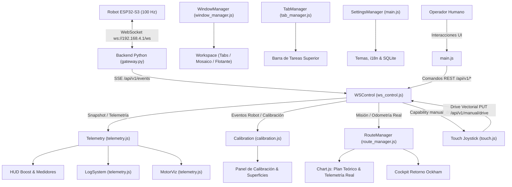

# Arquitectura JavaScript del HMI Canónico (`desktop_app/robot_app/hmi/js/`)

Este directorio contiene los módulos JavaScript del **Frontend Canónico (HMI)** para el robot diferencial 4WD basado en **ESP32-S3** (`robot-s3-steps-v3` / firmware `v3.7+`).

El sistema implementa una interfaz de estación de control para telemetría en tiempo real (100 Hz), calibración física basada en giróscopo MPU6050, planificación cartográfica de rutas con retorno Ockham, control manual táctil (Pointer Events) y gestión multi-panel de ventanas estilo sistema operativo (Pestañas, Mosaico Vertical con doble scroll y Flotante).

---

## 1. Principios de Arquitectura y Seguridad

### 1.1 Vanilla Moderno sin Dependencias Pesadas
El frontend prescinde deliberadamente de frameworks pesados (React, Vue, Angular) en favor de JavaScript modular nativo (ES6+), renderizado DOM directo y **Chart.js** con plugins de datalabels y zoom para lienzos cartográficos. Esto garantiza arranque instantáneo, latencia mínima en tablets Android e inmunidad ante incompatibilidades de WebViews empotrados.

### 1.2 Política de Seguridad de Contenido (CSP) y Token Local
- **CSP Estricto**: `web.py` inyecta un `nonce` criptográfico dinámico por cada petición HTTP. Quedan prohibidos scripts en línea sin nonce, `unsafe-inline` o `unsafe-eval`.
- **Autenticación `X-App-Token`**: Al iniciarse el servidor backend de Python, se genera un token de aplicación inyectado en `<meta name="app-token">`. Cada petición REST hacia `/api/v1/*` y cada invocación a endpoints críticos (`/api/v1/commands`, `/api/v1/estop`, `/api/v1/manual/*`) debe incluir la cabecera `X-App-Token`.
- **Propiedad Única de WebSocket**: El navegador **nunca** se conecta directamente por WebSocket al ESP32. En su lugar, el backend en Python (`gateway.py`) es el dueño único del WebSocket hacia el robot (`ws://192.168.4.1/ws`), reenviando la telemetría al navegador mediante **Server-Sent Events (SSE)** en `/api/v1/events` y despachando comandos mediante REST.

### 1.3 Ensamblado Modular y Verificación (`compilar_hmi.py`)
El archivo maestro `index.html` actúa como esqueleto ligero. El script `compilar_hmi.py` concatena y valida los 10 módulos en el orden estricto de dependencias definido por `JS_ORDER`:

```python
JS_ORDER = [
    "config.js",
    "ws_control.js",
    "calibration.js",
    "telemetry.js",
    "fork_registry.js",
    "window_manager.js",
    "route_manager.js",
    "tab_manager.js",
    "touch.js",
    "main.js",
]
```

---

## 2. Diagrama de Flujo de Datos y Eventos



---

## 3. Catálogo Detallado de los 10 Módulos JavaScript

### 3.1 `config.js` — Constantes de Protocolo, Estado Global y Chart Base
- **Propósito**: Define los contratos canónicos de firmware y aloja el estado global reactivo de la aplicación.
- **Estructuras Principales**:
  - `CANONICAL_CONFIG`: Define `PROTOCOL_NAME = 'robot-s3-steps-v3'`, `EXPECTED_FIRMWARE = 'robot-s3-v3.7'`, y el conjunto de comandos autorizados `SUPPORTED_COMMANDS: Set(['calibrate','step','turn_to','stop','estop','clear_fault','set_comp','reset_pose'])`.
  - `CONFIG`: Límites de UI (`MAX_RPM_VISUAL`, `MIN_RPM_VISUAL`, `TRAIL_MAX`, `LOG_MAX`, `JOYSTICK_MAX_RADIUS = 108`, `JOYSTICK_DEAD_ZONE = 18`).
  - `state`: Objeto mutable global que contiene conexión (`connected`), estado FSM de la UI (`estado`), telemetría cruda en memoria, filtros de bitácora, vector de joystick (`joy`) y soporte de conducción manual (`manualDriveSupported`).
- **Gráfica de Navegación Básica**:
  - `initChart()` / `robotChart`: Inicializa la gráfica de dispersión de `tab_mapa.html` con plugins de datalabels y zoom panorámico.

---

### 3.2 `ws_control.js` — Transporte SSE, API REST y Despacho de Comandos
- **Propósito**: Capa de red que conecta la interfaz con los servicios REST y la cola de eventos SSE del servidor local de Python.
- **Objeto**: `WSControl`
- **Métodos y Responsabilidades**:
  - `init()` / `connectBackend()`: Abre la conexión `EventSource('/api/v1/events')`, escucha eventos `snapshot`, `telemetry`, `connection`, `session`, `mission`, `robot_event`, y despacha a los manejadores de panel correspondientes.
  - `api(path, options)`: Wrapper sobre `fetch()` nativo que inyecta automáticamente la cabecera `X-App-Token` y maneja timeouts mediante `AbortController`.
  - `send(obj)`: Valida el comando contra `CANONICAL_CONFIG.SUPPORTED_COMMANDS` y despacha `POST /api/v1/commands` o `POST /api/v1/estop`.
  - `manual(path, payload)`: Envía solicitudes de control manual continuo (`/api/v1/manual/drive`, `/api/v1/manual/begin`, `/api/v1/manual/end`).
  - `applyBackendTelemetry(raw)`: Procesa tramas JSON de alta frecuencia (100 Hz). Extrae pulsos de los 4 encoders, PWM físico de 8 bits por lado, supervisión de stack RTOS de Core 0 y Core 1, jitter de control, diagnóstico de interlock de inversión y motivos de parada (`last_terminal`). Alimenta simultáneamente a `Telemetry`, `RouteManager`, `Calibration` y `ConnectionPanel`.

---

### 3.3 `calibration.js` — Dogma Canónico de Calibración MPU6050
- **Propósito**: Administra el flujo de calibración física del robot, algoritmos de detección de torque, aislamiento de encoders defectuosos y perfiles de compensación de superficie.
- **Objeto**: `Calibration`
- **Flujo del Dogma Canónico**:
  1. Reposo y estabilización del giróscopo MPU6050 (5.0 s).
  2. Búsqueda de torque positivo (`CAL_A`): Rampa de PWM (140 a 247/255) hasta validar ticks en ambos lados y $\omega_z \ge 0.12\text{ rad/s}$ sostenido por 100 ms.
  3. Validación de giro a $+25^\circ$ (`CAL_VALIDAR_25`) con reposo de 600 ms.
  4. Reposo de 2.5 s y búsqueda de torque opuesto (`CAL_B`) validando polaridad contraria.
  5. Retorno a origen (`CAL_RETORNO`) al yaw original, reseteando odometría $(0,0)$ e IMU.
- **Gestor de Superficies (`SurfaceManager`)**:
  - Persiste y carga perfiles de fricción en SQLite (`/api/v1/surfaces`), permitiendo guardar parámetros cinemáticos óptimos para distintas superficies (acrílico, madera, alfombra).
  - Incluye guardado automático post-calibración y aplicación dinámica de coeficientes (`set_comp`).

---

### 3.4 `telemetry.js` — Logs Jerárquicos, Instrumentación y Visualización de Ruedas
- **Propósito**: Mantiene el historial de eventos del sistema, anima las ruedas 4WD según PWM/dirección y gobierna la instrumentación del chasis.
- **Componentes**:
  - `LogSystem`: Bitácora en memoria circular (hasta 500 registros) con filtros activos (INFO, WARN, ERROR, CMD), auto-scroll inteligente, contador dinámico accesible y descarga de reportes en texto plano (`.txt`).
  - `MotorViz`: Motor de visualización a 60 FPS que calcula la rotación angular de los 4 motores TT (FL, FR, BL, BR) interpolando la velocidad visual según el PWM aplicado y el sentido de giro.
  - `Telemetry`: Máquina de estados visual superior. Mapea estados de firmware (`listo`, `calibrando`, `ejecutando`, `manual`, `estop`, `fallo`) hacia insignias de color en la UI, actualiza odometría en tiempo real y calcula distancias recorridas.

---

### 3.5 `fork_registry.js` — Arquitectura Extensible de Submódulos y Widgets
- **Propósito**: Proporciona un registro desacoplado para instanciar ventanas secundarias, widgets flotantes y bifurcaciones de ruta.
- **Objeto**: `HMI_FORK_REGISTRY`
- **Módulos Integrados**:
  - `hud_boost`: Widget del HUD Cinético y Boost DRV8833 (`tab-boost`), con acelerómetro, inclinómetro lateral/longitudinal y monitor de corriente/térmico.
  - `route_fork`: Generador de ventanas clonadas de rutas para planificación y comparación A/B de trayectorias.
- **API Pública**:
  - `register(id, definition)`: Registra un nuevo tipo de ventana con metadatos, icono y fábrica de instanciación.
  - `createInstance(id, options)`: Solicita a `WindowManager` crear o enfocar la ventana asociada.
  - `list()`: Enumera los módulos disponibles para poblar el menú desplegable de herramientas (`···`).

---

### 3.6 `window_manager.js` — Gestor de Ventanas y Modos de Disposición
- **Propósito**: Gobierna la experiencia multi-ventana estilo escritorio en el navegador, soportando tres modos de trabajo:
  1. `tabs`: Pestañas clásicas maximizadas de vista única.
  2. `tiling`: **Mosaico Vertical** con apilamiento hacia abajo a ancho completo (100%), scroll general en el espacio de trabajo y scroll independiente por tarjeta.
  3. `floating`: Ventanas flotantes arrastrables con capas z-index y redimensión libre.
- **Características Clave**:
  - **Mosaico Vertical Stacking**: En modo mosaico, cada tarjeta ocupa `width: 100%` y una altura vertical acotada (por defecto 520px, ajustable con el tirador táctil). El contenedor `#hmi-workspace` provee scroll vertical general (`overflow-y: auto`), mientras que el interior de cada ventana contiene su propio scroll (`overflow-y: auto`), permitiendo que mapas, consolas y tablas convivan sin colapsar.
  - **Gestión de Tirador Táctil (`_startResize`)**: Soporte Pointer Events de 28px con `setPointerCapture`. En modo mosaico vertical, ajusta dinámicamente la altura `tilingHeight` preservándola en `state` y `ResizeObserver`.
  - **Foco y Z-Index (`bringToFront`)**: Eleva la ventana activa por encima de las demás y sincroniza la barra de tareas.

---

### 3.7 `route_manager.js` — Planificador Cartográfico y Retorno Ockham
- **Propósito**: Módulo de alta precisión cartográfica para planificación y ejecución autónoma de waypoints.
- **Capacidades**:
  - **Modos de Inserción**: Coordenadas rectangulares cartesianas $(X, Y)$, coordenadas angulares polares (magnitud + ángulo) descompuestas en vectores ejecutables, y vectores relativos.
  - **Doble Lienzo Cartográfico (Chart.js)**:
    - *Plan Teórico* (`card-plan-map`): Dispersión con interpolación lineal, flechas de vector y etiquetas de waypoints.
    - *Telemetría Real* (`card-telem-map`): Trayectoria real del robot en tiempo real según la odometría fusionada de Core 1.
  - **Modo Cine Desduplicado (`toggleCinema`)**: Permite expandir a pantalla completa tanto el Plan Teórico como la Telemetría Real de forma independiente mediante botones específicos `Cine (Plan)` y `Cine (Telemetría)` con iconos SVG y atajo de teclado `Esc`.
  - **Cockpit Ockham (Retorno a Origen)**: Genera la ruta de regreso desandando waypoints en orden inverso ($W_N \to \dots \to W_0$). Aplica etapa de reposo (settling de 500 ms) tras cada tramo para evaluar errores de exactitud (longitudinal, lateral y angular) y realineación dinámica si el error angular supera $1.5^\circ$ o el lateral supera $2.5\text{ cm}$.

---

### 3.8 `tab_manager.js` — Navegación de Pestañas y Barra de Tareas
- **Propósito**: Coordina la selección activa de pestañas superiores y las integra con la barra de tareas.
- **Objeto**: `TabManager`
- **Funciones Principales**:
  - `init()`: Vincula botones de pestaña (`.tab-btn`), gestiona accesibilidad WAI-ARIA (`role="tab"`, `aria-selected`, navegación por teclado con flechas, Home y End).
  - `switch(id)`: Cambia la pestaña activa, valida condiciones de seguridad (p. ej., bloquear pestañas si el robot no está calibrado o si una ruta está en ejecución activa), sincroniza visibilidad DOM y en modo mosaico ejecuta `scrollIntoView({ behavior: 'smooth', block: 'nearest' })`.

---

### 3.9 `touch.js` — Control Manual Táctil y Joystick Virtual
- **Propósito**: Conducción manual en tiempo real por joystick virtual mediante Pointer Events, con soporte de leasing de seguridad y grabación de trayectorias.
- **Objeto**: `Touch`
- **Detalles Técnicos**:
  - **Pointer Events con Captura**: Utiliza `pointerdown`, `pointermove`, `pointerup` con `setPointerCapture` en el contenedor SVG del joystick, garantizando que el arrastre no se pierda si el dedo o puntero sale del círculo.
  - **Cinemática de Tracción Diferencial**: Convierte la posición $(X, Y)$ del pulgar en componentes de avance y giro, respetando la zona muerta (`JOYSTICK_DEAD_ZONE = 18px`) y escalando PWM con piso dinámico contra el límite de 242/255.
  - **Corte Inmediato en Parada**: Al soltar el joystick (`Touch.end()`), emite de inmediato PWM en cero `{ left: 0, right: 0 }` y cierra el lease en el backend.
  - **Grabación y Replay de Trayectoria**: Permite grabar una sesión manual de maniobras y ejecutar un retorno automático reproduciendo los vectores inversos.

---

### 3.10 `main.js` — Orquestador de Aplicación y Gestor de Configuración
- **Propósito**: Punto de entrada (`DOMContentLoaded`), enlace de eventos globales del DOM, persistencia de preferencias y atajos de teclado.
- **Componentes**:
  - `SettingsManager`: Gestiona configuraciones de usuario: tema visual (`cyber-dark`, `light-glass`, `high-contrast`), idioma (`es`, `en`), modo de espacio de trabajo por defecto (`tabs`, `tiling`, `floating`) y modo de grabación de telemetría. Persiste en `localStorage` y sincroniza con SQLite en `/api/v1/settings`.
  - **Atajos de Teclado**: Soporte para parada de emergencia con `Espacio`, salida de modo cine con `Esc` y navegación rápida.
  - **Enrutamiento por Hash de URL**: Detecta rutas como `#/plan` o `#/boost` al cargar para activar y enfocar automáticamente las ventanas correspondientes.
  - **Mantenimiento de Base de Datos**: Permite purgar registros antiguos de SQLite por días de antigüedad con confirmación modal de seguridad.

---

## 4. Guía de Verificación y Pruebas

Cualquier modificación a estos módulos JavaScript debe ser verificada ejecutando las suites canónicas:

1. **Ensamblado y Validación Modular**:
   ```powershell
   desktop_app\.test-venv\Scripts\python.exe desktop_app/robot_app/hmi/compilar_hmi.py --check
   ```
2. **Suite de Pruebas de Contrato Frontend (Vitest - 27 pruebas)**:
   ```powershell
   npm --prefix desktop_app/frontend test
   ```
3. **Suite de Backend Python (102 pruebas)**:
   ```powershell
   $env:PYTHONPATH="desktop_app"; & desktop_app\.test-venv\Scripts\python.exe -m unittest discover desktop_app/tests
   ```
